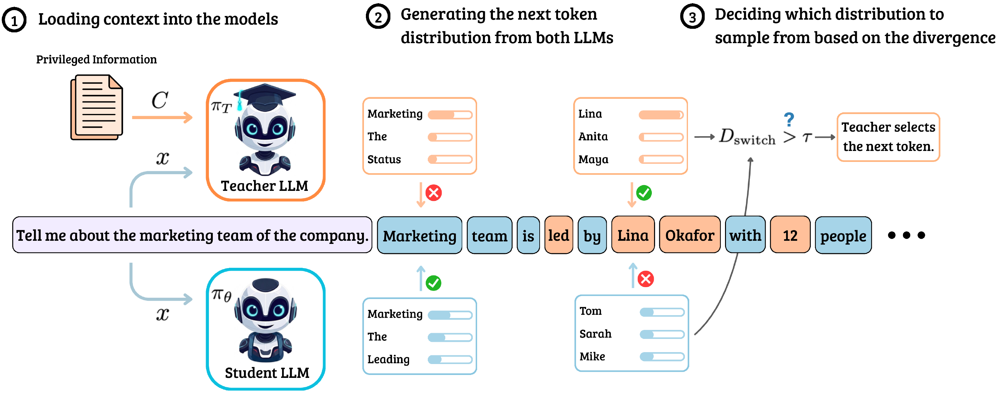
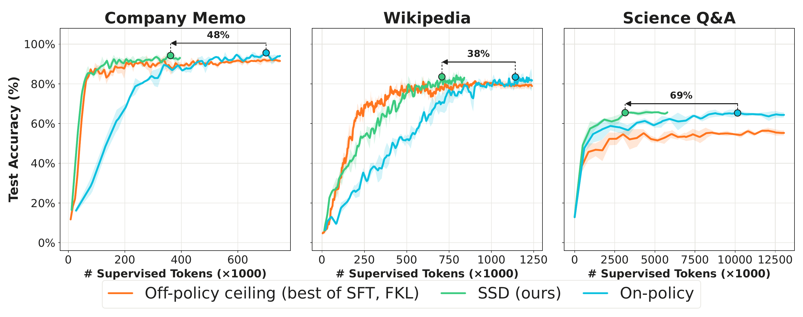
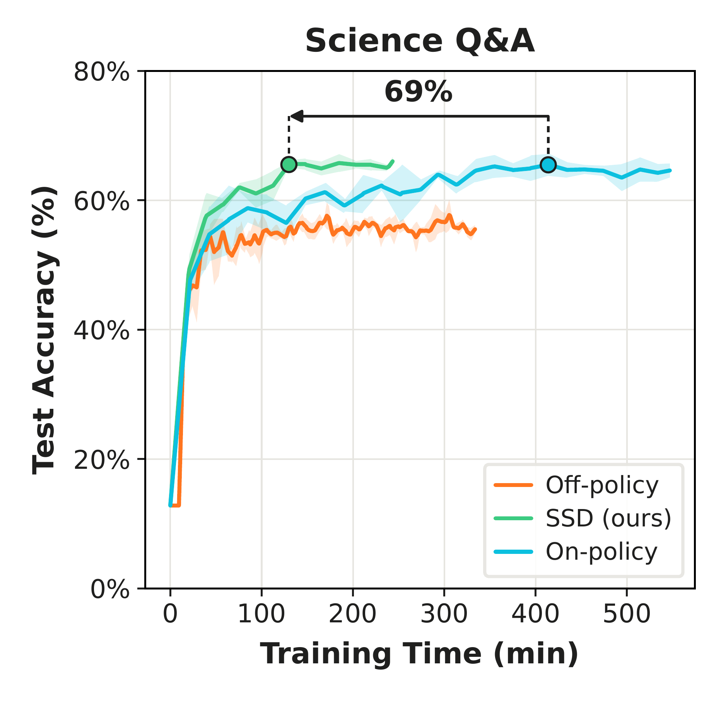

<!-- markdownlint-disable MD001 MD033 MD041 -->
<p align="center">
  
</p>

<h3 align="center">
Speculative Self-Distillation
</h3>

<p align="center">
<i>Efficient Knowledge Internalization for Language Models</i>
</p>

<p align="center">
| 📄 <a href="https://arxiv.org/abs/2611.12016"><b>Paper</b></a> | 🌐 <a href="https://ssd-distill.github.io/"><b>Project Page</b></a> | 🛠️ <a href="#reproducing-the-paper"><b>Reproduce</b></a> | 📚 <a href="#citation"><b>Citation</b></a> |
</p>

🔥 **Speculative Self-Distillation (SSD)** trains a language model to internalize
knowledge it only sees in context. A teacher (the model with the privileged
context in its prompt) and a student (the same model without it) decode a rollout
together: the student writes by default, and the teacher takes over only at
**inflection positions**, where the context changes the next-token distribution.
Every position is trained with the same distillation loss.

- On three closed-book QA tasks (Company Memo, Wikipedia, Science Q&A), SSD nearly
  matches on-policy self-distillation while using **38–69% fewer supervised tokens**
  (48%, 38% and 69% on the three tasks).
- With teacher and student decoding concurrently in a modified vLLM engine, SSD
  reaches the on-policy accuracy on Science Q&A in **69% less training time**.
- A single threshold τ interpolates between off-policy (τ → 0) and on-policy
  (τ → ∞) self-distillation.

<p align="center">
  
</p>

---

## Installation

Requirements: Linux, Python 3.12, CUDA GPUs with 80 GB of memory. SSD runs the
student and the teacher on two GPUs (NVLink is used to refresh an EMA teacher);
the on-policy, SFT and FKL baselines use one GPU.

```bash
git clone https://github.com/ShayanTalaei/SpeculativeSelfDistillation.git
cd SpeculativeSelfDistillation
bash setup.sh                                    # Python 3.12 venv with the pinned packages + model download
.venv/bin/python scripts/prepare_data.py all     # builds the three datasets
export WANDB_API_KEY=...                         # or pass --no-wandb to the run scripts
```

Models are downloaded to `$HF_HOME` (default `scratch/huggingface`); keep the same
`HF_HOME` when running `setup.sh`, the run scripts and `serve_judge.sh`.
Pinned versions are in `configs/versions.yaml`; every run records the installed
ones next to them in `<output>/versions.json`.

## Quickstart

Train SSD on Science Q&A (two GPUs):

```bash
.venv/bin/python scripts/run_ssd.py configs/ssd_scienceqa.yaml --output runs/ssd-scienceqa-s42
```

Company Memo and Wikipedia are scored by an LLM judge. Start it on a GPU before
training on those tasks (it takes about 15% of the GPU's memory and can share
the GPU with a trainer):

```bash
JUDGE_GPU=1 bash scripts/serve_judge.sh
.venv/bin/python scripts/run_ssd.py configs/ssd_company_memo.yaml --output runs/ssd-company-memo-s42
```

To check an installation end to end, `bash scripts/smoke.sh` runs every config
for 20 steps with two evaluations.

## Reproducing the paper

There is one config per method and task in `configs/`. These are the runs behind
the main results of the paper (accuracy against supervised tokens and against
training time); the paper reports the mean of seeds 42, 43 and 44.

| Method | Script | Configs | Rollouts |
|---|---|---|---|
| **SSD** | `scripts/run_ssd.py` | `ssd_{company_memo,wikipedia,scienceqa}.yaml` | The student writes; the teacher takes over when the student–teacher divergence is above τ |
| **On-policy** (SDFT) | `scripts/run_onpolicy.py` | `onpolicy_*.yaml` | The student writes the whole rollout |
| **Off-policy SFT** | `scripts/run_sft.py` | `sft_*.yaml` | Teacher completions sampled once before training; cross-entropy |
| **Off-policy FKL** | `scripts/run_fkl.py` | `fkl_*.yaml` | Same teacher completions; forward KL to the teacher |

```bash
for task in company_memo wikipedia scienceqa; do
  for seed in 42 43 44; do
    .venv/bin/python scripts/run_ssd.py      configs/ssd_${task}.yaml      --seed $seed --output runs/ssd-${task}-s${seed}
    .venv/bin/python scripts/run_onpolicy.py configs/onpolicy_${task}.yaml --seed $seed --output runs/onpolicy-${task}-s${seed}
    .venv/bin/python scripts/run_sft.py      configs/sft_${task}.yaml      --seed $seed --output runs/sft-${task}-s${seed}
    .venv/bin/python scripts/run_fkl.py      configs/fkl_${task}.yaml      --seed $seed --output runs/fkl-${task}-s${seed}
  done
done
```

Add `--gpus ...` to override the config's GPUs, or `--dry-run` to print the
trainer command. Metrics go to W&B (project `speculative-self-distillation`, run
`<task>_<method>_s<seed>`) and to `<output>/train.log`. The configs do not save
weights; set `save_final_model: true` to write `<output>/final/`.

<p align="center">
  
</p>

The forgetting study (Qwen2.5-7B), the Qwen3-14B run, the switching-rule ablation
and the signal analysis in the paper are not part of this release.

## How SSD works

`src/train.py` with `engine=paired_vllm` builds `SSDDistilTrainer`
(`src/ssd/distil_trainer.py`), which starts `paired_vllm.server` in a separate
process. The server holds a student vLLM worker on GPU 0 (sharing the GPU with
training) and a teacher worker on GPU 1. At each optimizer step:

1. **Weight refresh.** The trainer exports the live student weights as CUDA IPC
   handles, and the server maps them into the student worker without a copy.
   With an EMA teacher, the reference model is exported the same way and the
   teacher worker pulls it over NVLink.
2. **Joint decoding.** Both workers decode in lockstep. At each position the
   student proposes a token, the teacher's next-token distribution is compared
   with the student's (JSD or KL), and the teacher's token replaces the
   student's when the divergence is above τ. The provenance of every token is
   recorded.
3. **Loss.** The teacher's final hidden states for the completion stay on
   GPU 0. The loss projects them through the teacher head to get the teacher's
   log-probabilities and computes the forward KL to the student at every
   position.

Joint decoding runs at about 92% of the throughput of student-only decoding, so
an SSD step costs about as much as an on-policy step.

<p align="center">
  
</p>

## Data

All three tasks follow SDFT ([Shenfeld et al., ICML 2026](http://idanshenfeld.com/SDFT)).

- **Company Memo** and **Wikipedia** (Cyclone Ditwah) use the question–answer
  pairs from SDFT, included in `data/`. The Wikipedia source text in
  `data/wikipedia/` is the [Cyclone Ditwah](https://en.wikipedia.org/wiki/Cyclone_Ditwah)
  article from Wikipedia, available under
  [CC BY-SA 4.0](https://creativecommons.org/licenses/by-sa/4.0/).
- **Science Q&A** is the Chemistry Level-3 subset of SciKnowEval
  ([Feng et al.](https://arxiv.org/abs/2406.09098)), as distributed with SDFT;
  `scripts/prepare_data.py` downloads and formats it.

In every task the teacher's privileged context is the question's reference answer.

## Directory structure

```
.
├── configs/                 # one YAML per method and task, plus versions.yaml (pinned packages)
├── scripts/
│   ├── run_ssd.py           #   SSD entry point          ┐
│   ├── run_onpolicy.py      #   on-policy entry point    │ all four call scripts/launch.py
│   ├── run_sft.py           #   off-policy SFT           │ (config -> trainer command)
│   ├── run_fkl.py           #   off-policy FKL           ┘
│   ├── prepare_data.py      #   builds the datasets and evaluation files
│   ├── serve_judge.sh       #   vLLM judge server for Company Memo and Wikipedia
│   └── smoke.sh             #   20-step check of every config
├── src/
│   ├── train.py             # on-policy (engine=vllm) and SSD (engine=paired_vllm) trainer
│   ├── train_off_policy.py  # SFT / FKL on teacher completions sampled once before training
│   ├── distil_trainer.py    # TRL-based on-policy distillation trainer (vLLM rollouts, KL loss)
│   ├── distil_config.py     # its configuration
│   ├── ssd/                 # SSD trainer: routing strategies, loss masking, paired-engine bridge,
│   │                        #   GPU-resident teacher targets, timing and run records
│   ├── data/                # dataset builder; Company Memo / Wikipedia and Science Q&A loaders
│   └── evals/               # online evaluation, LLM judge and exact-match scorers
├── paired_vllm/             # two-GPU vLLM engine used by SSD: student and teacher workers,
│                            #   divergence-based token routing, CUDA IPC weight refresh
├── data/                    # Company Memo and Wikipedia question-answer pairs
├── tests/                   # unit tests (CPU) and GPU integration tests (PAIRED_GPU_TESTS=1)
└── assets/                  # figures used in this README
```

## Citation

```bibtex
@misc{talaei2026speculativeselfdistillationenablesefficient,
      title={Speculative Self-Distillation enables Efficient Knowledge Internalization}, 
      author={Shayan Talaei and Agam Bhatia and Arshia Soltani Moakhar and Jonas Hübotter and Amin Saberi and Azalia Mirhoseini},
      year={2026},
      eprint={2611.12016},
      archivePrefix={arXiv},
      primaryClass={cs.LG},
      url={https://arxiv.org/abs/2611.12016}, 
}
```

## License

This project is released under the [Apache 2.0 License](LICENSE).
